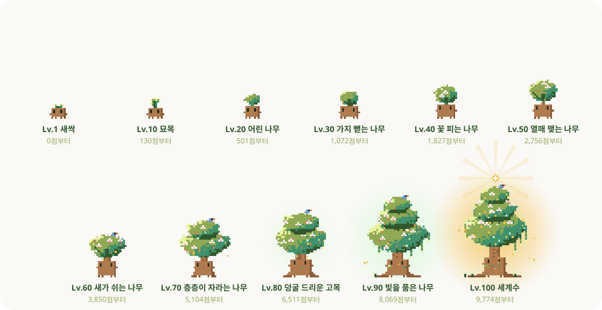

<p align="center">
  
</p>

<p align="center">
  
  
  
  
  
</p>

<p align="center">
  <strong>새록이는 추천, 기획, 분석과 학습 에이전트를 열매처럼 하나씩 맺어 가는 개인 AI 에이전트 프로젝트입니다.<br>모든 열매는 출처와 근거를 함께 보여 주고, 확인할 수 없는 것은 확정하지 않습니다.</strong>
</p>

<p align="center">
  
</p>

## 🧺 바로 써 보기

Claude Code 대화창에서 새록이 플러그인 모음을 한 번만 등록합니다.

```text
/plugin marketplace add jhheo51-arch/saeroki
```

그다음 쓰고 싶은 에이전트만 골라 설치하고 Claude Code를 다시 엽니다. Python 3.10 이상이 필요합니다.

| 에이전트 | 하는 일 | 설치 | 쓰는 법 |
|---|---|---|---|
| 🍎 [4 새록 검토관](fruits/04-prd-assistant) | PRD를 스무고개로 설계하고 기준표 7개로 검사 | `/plugin install saerok-prd@saeroki` | `/saerok-prd:design <만들 것>`<br>`/saerok-prd:review <PRD 파일>` |
| 🌸 [18 새록 파수꾼](fruits/18-saerok-watch) | 대화가 20만·40만 토큰을 넘으면 알리고, 토큰이 새는 곳을 대시보드로 | `/plugin install saerok-watch@saeroki` | 설치하면 바로 지켜봄<br>`/saerok-watch:dashboard` |
| 🌸 [19 새록 면접관](fruits/19-saerok-interview) | 면접관 5명이 자기소개서를 심사하고 근거 달린 예상 질문 10개 | `/plugin install saerok-interview@saeroki` | `/saerok-interview:panel`<br>`/saerok-interview:practice` |
| 🌸 [20 새록 심사단](fruits/20-saerok-idea) | 서비스 아이디어를 심사위원 3명이 진행·조건부·보류로 판정 | `/plugin install saerok-idea@saeroki` | `/saerok-idea:judge <아이디어 한 줄>` |

**설치 없이 브라우저에서:** [📖 17 새록 사전](https://jhheo51-arch.github.io/saeroki/) · [🎤 19 면접관 화면](https://jhheo51-arch.github.io/saeroki/interview/) · [⚖️ 20 심사단 화면](https://jhheo51-arch.github.io/saeroki/idea/)  
<sub>면접관·심사단 화면은 내 Claude API 키로 동작하고 기록은 그 브라우저에만 남습니다.</sub>

<details>
<summary>터미널에서 설치하거나 끄기</summary>

```bash
claude plugin install saerok-watch --marketplace jhheo51-arch/saeroki
claude plugin disable saerok-watch
```

`saerok-watch` 자리에 `saerok-prd`, `saerok-interview`, `saerok-idea`를 넣으면 됩니다. 파수꾼은 Claude Code 설정을 내가 적용 탭에서 고른 것만, 백업한 뒤 바꿉니다.

</details>

## 이름과 약속

> `새`는 새로운 발견, `록`은 기록을 뜻합니다.
>
> **새록이, 쓸수록 자라는 나만의 AI 에이전트 나무**

열매마다 하는 일은 달라도 약속은 같습니다. 많이 보여 주기보다 지금 확인할 가치가 있는 것만 건네고, 출처와 이유를 함께 보여 주며, 근거가 없으면 억지로 답하지 않습니다.

| 발견 | 기록 | 확인 |
|---|---|---|
| 관심사와 현재 상황에 맞는 후보를 찾습니다. | 저장, 이미 앎, 관심 없음과 너무 유명함을 기록합니다. | 출처, 날짜와 추천 이유가 없으면 결과를 확정하지 않습니다. |

## 새록이 열매 지도

새록이는 나무라서 에이전트도 나무의 말로 부릅니다. 사용자가 직접 쓰는 에이전트는 씨앗에서 꽃을 거쳐 **열매**로 자라고, 에이전트를 받치는 공통 기반은 **뿌리**입니다.

**에이전트 16개(🍎 열매 1 · 🌸 꽃 6 · 🌱 씨앗 9) · 뿌리 4개**

| 상태 | 뜻 |
|---|---|
| 🌱 씨앗 | 기획만 저장했습니다 |
| 🌸 꽃 | 만드는 중입니다 |
| 🍎 열매 | 첫 버전을 완성했습니다 |

### 에이전트 16개

에이전트마다 [`fruits/`](fruits) 아래에 폴더 하나를 둡니다. 씨앗 폴더에는 아직 설명만 있습니다.

| 갈래 | 열매 |
|---|---|
| 추천 | 🌸 [1 콘텐츠 개인화](fruits/01-content-personalization) · 🌱 [6 레시피](fruits/06-recipe) · 🌱 [11 도서](fruits/11-book-recommendation) |
| 기획 | 🌱 [3 마케팅 전략](fruits/03-marketing-strategy) · 🍎 [4 새록 검토관(PRD 설계 지원)](fruits/04-prd-assistant) · 🌸 [20 새록 심사단(아이디어 검증)](fruits/20-saerok-idea) |
| 조사와 분석 | 🌱 [7 금융](fruits/07-finance) · 🌱 [8 미디어 트렌드](fruits/08-media-trend) · 🌱 [9 법률 문서(10번 통합)](fruits/09-legal-document) · 🌱 [15 심층 연구](fruits/15-deep-research) |
| 데이터 | 🌱 [5 데이터 시각화](fruits/05-data-visualization) · 🌸 [16 새록 SQL(자연어 SQL)](fruits/16-natural-language-sql) |
| 학습 | 🌸 [17 새록 사전(산업별 용어 사전)](fruits/17-saerok-dictionary) · 🌸 [19 새록 면접관(모의 면접)](fruits/19-saerok-interview) · 🌱 [21 새록 지원서(공고 분석·자기소개서)](fruits/21-saerok-apply) |
| 돌봄 | 🌸 [18 새록 파수꾼(토큰 사용량 감시)](fruits/18-saerok-watch) |

### 뿌리 4개

| 뿌리 | 하는 일 |
|---|---|
| 🌱 2 Agno | 열매들을 실행하는 공통 운영 기반(미도입) |
| 🌸 12 정보 수집 | 공개 출처에서 후보를 모읍니다 |
| 🌸 13 계획 후 실행 | 실행 계획을 세우고 단계를 기록합니다 |
| 🌸 14 결과 자기 검토 | 결과를 스스로 확인하고 고칩니다 |

번호는 처음 정한 에이전트 번호입니다. 1번부터 16번까지의 원래 목록과 나중에 더한 17번은 [PRD v01](docs/PRD-v01.md)에, 18번은 [PRD v1.9](docs/PRD-v1.9.md)에, 4번 새록 검토관 설계는 [PRD v2.0](docs/PRD-v2.0.md)에, 19번 새록 면접관 설계는 [PRD v2.1](docs/PRD-v2.1.md)에, 20번 새록 심사단 설계는 검토관 PRD의 짝 문서 [PRD v2.0-idea](docs/PRD-v2.0-idea.md)에, 21번 새록 지원서 설계는 [PRD v2.2](docs/PRD-v2.2.md)에 있습니다. 최신 상태는 이 열매 지도가 기준이고, 2026-10-14 시점 구현 기록은 [PRD v1.5](docs/PRD-v1.5.md)에 남겨 둡니다. 뿌리 12~14는 지금 [1번 열매](fruits/01-content-personalization) 코드 안에 있으며, 다른 열매가 함께 쓰게 되면 따로 떼어 냅니다.

## 자라는 새록이

새록이는 작은 묘목입니다. 작업을 이어 가고, 사람들이 이 페이지를 찾아오고 스타를 누를수록 Lv.1 새싹에서 Lv.100 세계수까지 자랍니다. 생김새는 레벨마다 모두 다르고, 10레벨마다 새 특징이 하나씩 생깁니다.

<p align="center">
  
</p>

| 레벨 | 이름 | 새로 생기는 모습 |
|---:|---|---|
| 1~9 | 새싹 | 떡잎이 커지고 줄기가 올라옵니다 |
| 10~19 | 묘목 | 줄기를 따라 잎이 번갈아 납니다 |
| 20~29 | 어린 나무 | 둥근 잎 덩어리가 생깁니다 |
| 30~39 | 가지 뻗는 나무 | 잎 사이로 가지가 보입니다 |
| 40~49 | 꽃 피는 나무 | 분홍 꽃이 핍니다 |
| 50~59 | 열매 맺는 나무 | 주황 열매가 열리고 빛 입자가 떠오릅니다 |
| 60~69 | 새가 쉬는 나무 | 파랑새가 앉고 줄기가 굵어집니다 |
| 70~79 | 층층이 자라는 나무 | 잎이 두 층으로 쌓이고 뿌리가 땅으로 퍼지며 후광이 비칩니다 |
| 80~89 | 덩굴 드리운 고목 | 덩굴이 늘어지고 몸통에 이끼가 낍니다 |
| 90~99 | 빛을 품은 나무 | 잎이 세 층이 되고 빛나는 잎과 발치의 새싹이 생깁니다 |
| 100 | 세계수 | 밤하늘 아래 빛의 씨앗과 금빛 열매, 빛줄기가 생깁니다 |

### 성장 점수

`성장 점수 = 순방문자 + 스타 × 10 + 작업량`

| 항목 | 세는 방법 |
|---|---|
| 순방문자 | GitHub traffic의 날짜별 순방문자를 더합니다. 한 사람은 새로고침을 여러 번 해도 하루 1점입니다. 저장소 주인의 방문도 포함됩니다. |
| 스타 | 저장소 주인을 뺀 스타 1개당 10점입니다. |
| 작업량 | 사람이 한 커밋마다 1점, 바뀐 줄 50줄마다 1점(커밋당 최대 4점), 작업한 날마다 3점입니다. 봇 커밋, 자동 생성 그림(`assets/`)과 `data/growth.json`은 세지 않습니다. |

- 레벨이 오를수록 필요한 점수가 커집니다. Lv.10은 130점, Lv.20은 501점, Lv.50은 2,756점, Lv.100은 9,774점부터입니다.
- 2026-10-14~15 이틀 동안 커밋 37개로 작업량 79점, Lv.7이 되었습니다. 지금처럼 꾸준히 작업하면 몇 달 안에 Lv.20~30, 해를 넘기면서 Lv.50 근처에 닿도록 맞췄습니다.
- 100레벨 전체 모습은 `python growth.py --preview all-levels.svg`로 한 장에 모아 볼 수 있습니다.
- GitHub Actions가 매일 서울 자정과 `main`에 push할 때 [`growth.py`](growth.py)를 실행해 그림을 다시 그립니다. 점수가 그대로면 기록을 바꾸지 않아 봇 커밋이 생기지 않습니다.
- 순방문자는 GitHub가 최근 14일만 알려 주므로 날짜별로 [`data/growth.json`](data/growth.json)에 쌓아 둡니다. 불러오지 못한 값은 0으로 바꾸지 않고 `확인 전`으로 남깁니다.
- 순방문자는 `TRAFFIC_TOKEN`을 등록해야 반영됩니다. 등록 전에는 스타와 작업량으로만 자랍니다.

<details>
<summary>순방문자 토큰 등록하기</summary>

1. GitHub `Settings` → `Developer settings` → `Fine-grained tokens`에서 새 토큰을 만듭니다. 저장소는 `saeroki`만 고르고 권한은 `Administration: Read-only`만 줍니다.
2. 저장소 `Settings` → `Secrets and variables` → `Actions`에 `TRAFFIC_TOKEN`이라는 이름으로 저장합니다.
3. `Actions` 탭의 `새록이 성장`에서 `Run workflow`를 누르거나 다음 자정 실행을 기다립니다.

</details>

## 프로젝트 지도

```text
saeroki/
├─ fruits/                 에이전트 16개(🍎1 · 🌸6 · 🌱9), 에이전트마다 폴더 하나
│  ├─ 01-content-personalization/   🌸 코드·데이터·검사·Claude 지침
│  ├─ 04-prd-assistant/             🍎 PRD 설계 스무고개·검토 스킬·검사 명령·예시·검사
│  ├─ 16-natural-language-sql/      🌸 saerok-sql 터미널·서울 데이터(data/)·검사
│  ├─ 17-saerok-dictionary/         🌸 사전 화면(web/)·용어집(data/)·검사
│  ├─ 18-saerok-watch/              🌸 토큰 감시 훅·대시보드(web/)·공개 집계(data/)·검사
│  ├─ 19-saerok-interview/          🌸 면접관 5명·심사·연습·비교 스킬·기록 명령·가상 예시·검사
│  ├─ 20-saerok-idea/               🌸 심사위원 3명·가정 검증·패널 스킬·판정 명령·가상 예시·검사
│  └─ 03 · 05 ~ 15 · 21 …           🌱 설명만 있는 씨앗 폴더
├─ docs/                   PRD와 Claude 이어하기 안내
├─ assets/ · data/growth.json · growth.py   자라는 새록이 그림과 성장 기록(Actions가 갱신)
├─ AGENT-SPEC.md           모든 열매가 지킬 공통 원칙
└─ AGENTS.md · CLAUDE.md   Codex·Claude 작업 안내
```

에이전트별 설치·실행 방법은 각 폴더의 README에 있습니다.

| 위치 | 내용 |
|---|---|
| [`docs/PRD-v01.md`](docs/PRD-v01.md) | 제품 방향, 열매 12개와 뿌리 4개의 원래 목록, 위험과 개발 순서 |
| [`docs/PRD-v1.5.md`](docs/PRD-v1.5.md) | 2026-10-14 시점 구현 범위와 상태 기록(최신 상태는 위 열매 지도) |
| [`docs/PRD-v1.6.md`](docs/PRD-v1.6.md) | 1번 콘텐츠 개인화 에이전트의 스무고개 확정 설계 |
| [`docs/PRD-v1.7.md`](docs/PRD-v1.7.md) | 17번 열매 새록 사전(산업별 용어 사전)의 스무고개 확정 설계 |
| [`docs/PRD-v1.8.md`](docs/PRD-v1.8.md) | 16번 열매 새록 SQL(자연어 SQL)의 스무고개 확정 설계 |
| [`docs/PRD-v1.9.md`](docs/PRD-v1.9.md) | 18번 열매 새록 파수꾼(토큰 사용량 감시)의 확정 설계 |
| [`docs/PRD-v2.0.md`](docs/PRD-v2.0.md) | 4번 열매 새록 검토관(PRD 검토)의 확정 설계 |
| [`docs/PRD-v2.1.md`](docs/PRD-v2.1.md) | 19번 열매 새록 면접관(모의 면접)의 스무고개 확정 설계 |
| [`docs/PRD-v2.0-idea.md`](docs/PRD-v2.0-idea.md) | 20번 열매 새록 심사단(아이디어 검증)의 스무고개 확정 설계. 검토관 PRD 버전을 따라 이름이 바뀜 |
| [`docs/PRD-v2.2.md`](docs/PRD-v2.2.md) | 21번 열매 새록 지원서(공고 분석·자기소개서 작성)의 스무고개 확정 설계 |
| [`docs/CLAUDE-HANDOFF.md`](docs/CLAUDE-HANDOFF.md) | Codex push 후 Claude Code pull 또는 웹앱 프로젝트 업로드 절차 |
| [`AGENT-SPEC.md`](AGENT-SPEC.md) | 모든 에이전트가 함께 지킬 판단 원칙 |
| [`AGENTS.md`](AGENTS.md) · [`CLAUDE.md`](CLAUDE.md) | Codex·Claude 작업 안내 |
| [`growth.py`](growth.py) | 성장 점수, 100레벨 계산과 픽셀 묘목 SVG 생성 |
| [`test_fruits.py`](test_fruits.py) | 루트에서 열매별 검사를 함께 돌리는 연결 파일 |

## 직접 확인하기

Python이 설치된 터미널에서 저장소 루트에 서서 다음 명령을 실행하면 성장 계산과 모든 열매의 검사를 함께 돌립니다.

```powershell
python -m unittest -v
```

열매별 실행 방법은 각 폴더의 README에 있습니다.

## 다음 잎사귀

### 🌿 할 일

- [ ] 18 새록 파수꾼 훅 설치 후 실제 대화에서 경고 한 줄 확인
- [ ] 4 새록 검토관으로 새 PRD 2개 검사, 지적 중 고친 비율 기록(2026-10-31까지)
- [ ] 20 새록 심사단으로 내 아이디어 1개 실제 심사, 판정과 다음 행동 기록
- [ ] 16 새록 SQL 어려운 세트 기대 행동 사람 판정
- [ ] 17 새록 사전 사용자 확인
- [ ] 17 새록 사전 Claude API 보충
- [ ] 1 콘텐츠 개인화: 추가 기술 블로그와 뉴스레터 RSS 주소 연결
- [ ] 1 콘텐츠 개인화: 날씨에 맞는 실제 음악 후보 출처 연결
- [ ] 1 콘텐츠 개인화: Claude 또는 OpenAI API 연결

<details>
<summary>✅ 한 일 41개</summary>

- [x] 제품군과 16개 후보를 정리한 PRD v01
- [x] 17번 산업별 용어 사전 에이전트 후보 추가
- [x] 에이전트를 열매 12개와 뿌리 4개로 정리
- [x] 17번 새록 사전 스무고개 설계 확정(PRD v1.7)
- [x] 새록 사전 첫 버전: 출처를 붙인 용어 132개와 사전 웹 화면
- [x] 새록 사전 출처 재검토: 뜻 137개 중 113개에 공식 문서 출처, 나머지 24개는 기업 자료 기준임을 화면에 표시
- [x] 새록 사전 금융·증권 산업 추가: 금융 용어 46개, 전체 용어 178개
- [x] 새록 사전 GitHub Pages 배포
- [x] 새록 사전 업무 공통 용어 42개, 뜻으로 찾기, 표준국어대사전 연결(전체 용어 220개)
- [x] 16번 새록 SQL 스무고개 설계 확정(PRD v1.8)
- [x] 새록 SQL 첫 버전: `saerok-sql` 대화형 터미널, 서울 생활 데이터 13개 표, 읽기 전용 안전 검사, 자동 수정, 기록 옮기기
- [x] 새록 SQL 무료 방식: Claude Code 스킬 `/saerok-sql`(API 키 없이 질문·풀이)
- [x] 새록 SQL 예시 질문 20개 채점: Claude Code 스킬 방식 20/20([결과](fruits/16-natural-language-sql/eval/RESULTS.md))
- [x] 18번 새록 파수꾼 설계 확정(PRD v1.9)
- [x] 새록 파수꾼 첫 버전: 기록 분석, 실시간 경고 훅, 대시보드(지금·추이·제안·적용), 백업·되돌리기
- [x] 4번 새록 검토관 설계 확정(PRD v2.0)과 첫 버전: 기준표 7개·줄 지적 4종 검사, 스킬 `/saerok-prd:review`
- [x] 새록 검토관 설계 스무고개 스킬 `/saerok-prd:design`, 고치기 전후 비교 `compare`
- [x] 4번 새록 검토관 🍎 열매 승격(2026-10-17): 설계 스무고개·검사·고치기 전후 비교 첫 버전 완성
- [x] 20번 새록 심사단 첫 버전(2026-10-17): 심사위원 3명·가정 검증·패널·손익분기·판정·다듬은 방향, 검토관 `--from` 연결, PRD 버전 자동 맞춤
- [x] 20번 새록 심사단 웹·터미널 화면(2026-10-17): 링크 하나로 여는 [심사 화면](https://jhheo51-arch.github.io/saeroki/idea/)과 터미널 `saerok-idea`
- [x] 새록 SQL 채점 정답 사람 검토(2026-10-17): 20문항 모두 맞음, 다시 채점 20/20
- [x] 새록 SQL 어려운 채점 세트 16문항(여러 표·함정·애매함·답할 수 없음): 자동 채점 11/11([결과](fruits/16-natural-language-sql/eval/RESULTS.md))
- [x] Claude와 Codex가 함께 읽는 공통 행동 원칙
- [x] 취향 저장, 출처 검사, 중복 제거와 추천 이유
- [x] 계획 후 실행, 결과 자기 검토와 실행 기록
- [x] 저장, 이미 앎, 관심 없음과 너무 유명함 피드백
- [x] 콘텐츠 개인화 공통 기반의 자동 검사 21개
- [x] 순방문자, 스타와 작업량으로 Lv.100 세계수까지 자라는 픽셀 묘목 새록이
- [x] 서울 시간대별 추천 구성
- [x] 서울 현재 날씨를 아침 음악 추천에 전달
- [x] API 없이 수동 YouTube Music 후보 목록 사용
- [x] 공개 웹페이지 메타데이터 파서
- [x] 확인된 공개 출처에서 후보 JSON 만들기
- [x] 공개 목록의 개별 링크를 후보로 바꾸는 기본 추출기
- [x] 뉴닉 공개 출처 후보와 수집 범위 기록
- [x] 뉴닉 주간 에디터 픽 공개 JSON에서 아티클 후보 만들기
- [x] INSIGHT 북마크 이름 59개 기록
- [x] RSS 2.0와 Atom 후보 변환기
- [x] AWS 한국 기술 블로그 RSS 주소 연결
- [x] 토스 테크, 카카오 테크, NAVER D2 RSS 주소 연결
- [x] 뉴닉 공개 목록에서 실제 아티클 링크 연결

현재 1번 콘텐츠 개인화 에이전트의 첫 작동 버전은 여기까지 구현했습니다. 서울 시간대별 추천, 날씨를 반영한 음악 후보, 출처가 확인된 글, 추천 이유, 피드백 저장과 다음 추천 반영을 포함합니다. 실제 RSS 자동 수집과 Claude API 연결은 다음 확장 범위입니다.

공통 기반이 실제 첫 추천 흐름에서 부족할 때만 다음 기술을 추가합니다.

</details>

---

<p align="center"><sub>Palette: #FAF9F6 / #ECF39E / #90A955 / #40916C / #31572C</sub></p>
